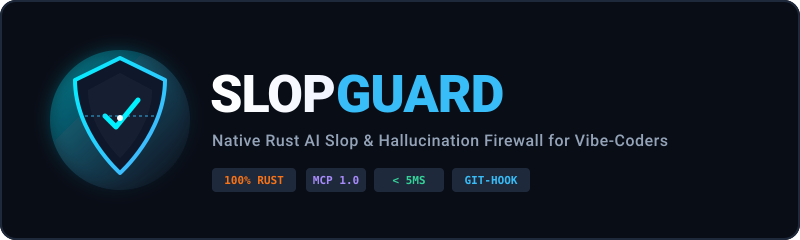

# SlopGuard Web Platform & Live AST Playground

<div align="center">
  
  <br>

  **[Live Platform](https://avelone123123.github.io/slopguard-site/)** | **[Core Rust Engine](https://github.com/avelone123123/slopguard)** | **[Discord](https://discord.gg/z7C9dprye)** | **[Telegram](https://t.me/SlopGuard)**

  <br>

  
  
  
  
</div>

---

## Overview

The official web platform for **SlopGuard**—the zero-latency native Rust AI slop and hallucination firewall.

Hosted live at: **[https://avelone123123.github.io/slopguard-site/](https://avelone123123.github.io/slopguard-site/)**

---

## Architectural Highlights

1. **Interactive AST Diff Playground**:
   - Zero-layout-shift live scanner supporting single-file audits and unified diff inspections.
   - Built-in scenario presets: Supply chain poison, unawaited async loop starvation, weak PRNG tokens, polyglot deserialization gadgets, and multi-encoded directory traversal.
   - Real-time remediation suggestions and code snippet sanitization.

2. **60-Firewall Command Matrix**:
   - Synchronized with SlopGuard Core Rust engine v3.3.0 (`AST_DETECTOR_DEFINITIONS`).
   - Categorized across 5 operational divisions:
     - **Supply Chain & Slopsquatting**: 13 active shields
     - **Async & Concurrency Guard**: 12 active shields
     - **Entropy & Credentials**: 12 active shields
     - **Path Traversal & Injection**: 13 active shields
     - **Code Quality & Memory Safety**: 10 active shields

3. **Pure SVG Vector Iconography**:
   - 100% vector SVG assets for UI buttons, status indicators, badges, and modal drawers. Zero emoji dependencies.

4. **Zero-Latency Client-Side Execution**:
   - No external trackers or analytics bloat.
   - Instant response with sub-millisecond client evaluation.

---

## Installation & Distribution

Install the official SlopGuard binary via Cargo:

```bash
cargo install --git https://github.com/avelone123123/slopguard.git --bin slopguard
```

Or from local workspace clone:

```bash
cargo install --path .
```

---

## Local Development & Preview

Serve the static site locally with any static file server:

```bash
# Using Python
python -m http.server 8080

# Or using Node.js npx serve
npx serve .
```

Open `http://localhost:8080` in your browser.

---

## Synchronization Matrix

| Attribute | Web Platform (`slopguard-site`) | Core Engine (`slopguard`) |
| :--- | :--- | :--- |
| Version | `v3.3.0` | `3.3.0` |
| AST Firewalls | 60 active | 60 active (`SLOP-001` .. `SLOP-060`) |
| Verified Unit Tests | 241 passed | 241 passed (100% pass rate) |
| Latency Target | < 0.42ms fast-path | < 2.5ms cold startup, < 0.42ms / 10k LOC |
| Assets | 100% pure SVG | 100% pure SVG |

---

## License

MIT © [avelone123123](https://github.com/avelone123123)
